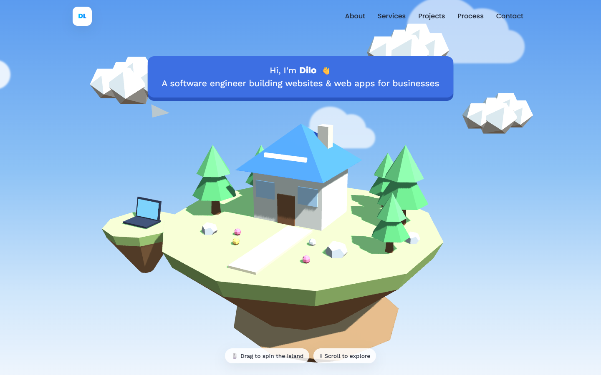

# Portfolio — Software Engineer · Data Analyst · Data Scientist

My personal portfolio as a software engineer, data analyst and data scientist: a light, playful site with a **floating low-poly 3D island built from scratch with Three.js** that visitors can drag to spin, followed by my projects, services and process.

**Stack:** HTML · CSS · JavaScript · Three.js (WebGL) — no framework, no template



---

## ✨ Highlights

- **3D hero made from code, not models** — the island, house, trees, floating laptop, clouds and paper plane are all built from Three.js primitives (cylinders, cones, boxes) with flat shading, soft shadows and a hemisphere + sun light setup.
- **Interaction & motion** — drag to rotate with inertia, gentle floating animation, drifting clouds; the render loop pauses when the hero is off-screen.
- **Projects shown like real products** — alternating rows with a browser-frame screenshot, problem, features and tech for each project, starting with real client work (Digital Smile).
- **Data & ML section** — six data projects (forecasting, churn prediction, segmentation, SQL analyses) with their key results, dashboard previews and links to each repository.
- **8 complete demo websites** in their own styles (restaurant, gym, beauty salon, e-commerce, real estate, photographer, SaaS, tradesman) in the sub-folders.
- **Polished details** — sticky nav that turns solid after the hero, active-section highlighting, reveal-on-scroll, morphing blob, animated vertical timeline.
- **Responsive & accessible** — tested from 375 px phones to desktop, keyboard focus styles, `prefers-reduced-motion` respected, no horizontal scroll.

## 📁 Structure

```
index.html          ← the portfolio (HTML + CSS + JS + Three.js scene)
img/                ← screenshots (projects, data/ dashboards)
restaurant/ gym/ beaute/ boutique/ immobilier/ photographe/ agence/ artisan/
                    ← the 8 demo websites
serve.js            ← tiny Node server for local preview
```

## 🚀 Run locally

```bash
node serve.js
```
Then open http://localhost:3212 — or simply open `index.html` in a browser.

---

**Author:** Hadil Ziane — Software Engineer · [GitHub](https://github.com/Hadil16)
